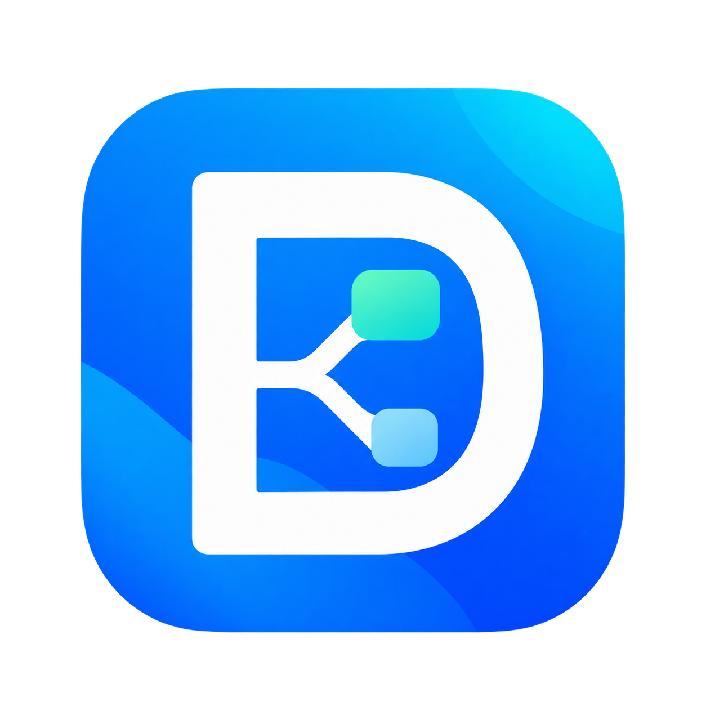

# DiskTree Studio

<div align="center">



**Bộ Ứng Dụng Quản Lý Lưu Trữ & Năng Suất Văn Phòng Thông Minh Chuẩn Windows Fluent UI**  
*The Modern, High-Performance Storage Management & Office Productivity Suite for Windows*

[](https://github.com/Vanhaoqb146/DiskTreeCleaner/releases)
[](https://github.com/Vanhaoqb146/DiskTreeCleaner/releases/latest)
[-0078D4?style=for-the-badge&logo=windows)](https://github.com/Vanhaoqb146/DiskTreeCleaner/releases)
[](https://github.com/Vanhaoqb146/DiskTreeCleaner/releases)

<br />

[**⬇️ TẢI BỘ CÀI ĐẶT MỚI NHẤT (DOWNLOAD v02.14.19)**](https://github.com/Vanhaoqb146/DiskTreeCleaner/releases/download/v02.14.19/DiskTreeStudio_Setup_02.14.19.exe)

</div>

---

## 🇻🇳 Giới thiệu tổng quan

**DiskTree Studio** (trước đây là *DiskTree Cleaner Pro*) là bộ giải pháp phần mềm toàn diện dành cho hệ điều hành Windows, kết hợp giữa khả năng **quản trị dung lượng ổ đĩa thông minh** và **công cụ nâng cao năng suất văn phòng**, hỗ trợ trí tuệ nhân tạo (AI) chạy 100% cục bộ (On-Device & Offline), bảo mật dữ liệu tuyệt đối.

Ứng dụng được thiết kế tỉ mỉ theo chuẩn **Windows 11 Fluent Design** (hỗ trợ cả Dark Mode & Light Mode), vận hành mượt mà, tối ưu hóa phần cứng đa luồng CPU và tăng tốc GPU.

---

### 🌟 Các tính năng nổi bật

1. **🌳 Cây Thư Mục & Biểu Đồ Khối Trực Quan (Disk Tree & Treemap Visualizer):**
   * Quét đa luồng tốc độ cao hàng triệu tệp tin chỉ trong vài giây.
   * Biểu đồ Treemap tương tác cho phép phóng to, thu nhỏ và nhận diện ngay những thư mục đang chiếm dung lượng khổng lồ.

2. **🔍 Tìm Kiếm Tệp Tin Thông Minh (Smart File Search — Tính năng mới):**
   * **Tìm nhanh tức thì**: Lọc theo tên tệp trong hàng trăm nghìn tệp tin với độ trễ cực thấp.
   * **Tìm trong nội dung**: Quét sâu nội dung bên trong các định dạng tài liệu phổ biến (`.docx`, `.pdf`, `.txt`, `.py`,...).
   * **Tìm theo ý nghĩa tự nhiên (Semantic AI Search)**: Ứng dụng mô hình AI Embeddings (E5/BGE) chạy hoàn toàn cục bộ trên máy tính, cho phép tìm kiếm tài liệu theo ngữ nghĩa của câu hỏi mà không phụ thuộc vào từ khóa chính xác, không cần kết nối mạng và không gửi dữ liệu ra bên ngoài.

3. **📝 Rà Soát & Sửa Văn Bản DOCX (Document Review & Correction — Tính năng mới):**
   * **Phát hiện lỗi thông minh**: Nhận diện lỗi chính tả, lỗi dấu câu, khoảng trắng thừa, ngữ pháp và rà soát theo chuẩn thể thức văn bản hành chính Việt Nam.
   * **Đối chiếu trực quan song song**: Gợi ý chỉnh sửa hiển thị trực quan bên cạnh bản gốc; người dùng chủ động duyệt và bấm áp dụng từng vị trí hoặc áp dụng toàn bộ.
   * **3 mức rà soát linh hoạt**:
     - *Cơ bản*: Rà nhanh bằng bộ quy tắc ngôn ngữ chuẩn.
     - *Nhanh*: Tăng cường mô hình AI ViT5 tối ưu hóa tiếng Việt.
     - *Chuyên sâu*: Rà soát ngữ cảnh nâng cao bằng mô hình AI Qwen 4B, hỗ trợ tăng tốc phần cứng GPU (Intel Iris Xe, NVIDIA, AMD qua Vulkan) và tùy chọn đa luồng CPU (2 / 4 / 8 luồng).
   * **Bảo vệ an toàn tuyệt đối**: Luôn lưu sang bản sao mới (`_da_ra_soat.docx`), tuyệt đối không ghi đè làm mất dữ liệu gốc; bảo toàn nguyên vẹn bố cục trang, hình ảnh và định dạng Word.

4. **📈 Dòng Thời Gian Biến Động Dung Lượng (Storage Timeline Intelligence):**
   * Chụp các mốc thời gian (snapshot) và so sánh biến thiên dung lượng từng thư mục giữa 2 thời điểm bất kỳ qua cơ sở dữ liệu SQLite v2 siêu nhẹ (~17.7 MB).
   * Cơ chế **Zero False Delta (Chống báo ảo)**: Phân định chính xác quét đầy đủ vs quét dở dang.
   * Biểu đồ thác nước (Waterfall Card) và Ngăn kéo bằng chứng (Evidence Drawer) trực quan hóa xu hướng phình to đĩa.

5. **🧑‍💻 Dọn Dẹp Lập Trình Viên & Cache (Developer & Cache Cleaner):**
   * Tự động quét và giải phóng 20–50 GB dung lượng từ các thư mục phát triển phần mềm: `node_modules`, Python `.venv`, `.pytest_cache`, build, target, Gradle, Maven, NuGet, Cargo, Docker cache,...

6. **🔍 Quét Tệp Trùng Lặp Chuyên Sâu (Deep Duplicate Finder Pro):**
   * Áp dụng thuật toán băm SHA-256 đối chiếu byte-to-byte chính xác 100%.
   * Toàn quyền chọn giữ lại hoặc xóa bất kỳ bản sao nào, hỗ trợ mở trực tiếp trong File Explorer.

7. **📦 Quản Trị Ứng Dụng & Tàn Dư (App Storage & Leftover Guard):**
   * Phân tích chi tiết dung lượng từng phần mềm đã cài đặt trên Windows: Dung lượng file thực thi, Cache tạm, Dữ liệu người dùng và Registry.
   * Phát hiện và dọn dẹp các tàn dư sót lại sau khi đã gỡ cài đặt phần mềm.

8. **🛡️ An Toàn Tuyệt Đối & Phục Hồi (5-Tier Safety & Undo):**
   * Phân loại rủi ro 5 cấp (từ An toàn đến Bảo vệ tuyệt đối).
   * Cơ chế xóa mặc định chuyển vào Thùng rác (Recycle Bin); ghi nhật ký kiểm toán và hỗ trợ hoàn tác (Undo) an toàn.

9. **🌐 Đa Ngôn Ngữ Song Ngữ 100%:**
   * Chuyển đổi linh hoạt tức thì giữa Tiếng Việt và English trực tiếp trong phần Cài đặt.

---

## 🇬🇧 Overview (English)

**DiskTree Studio** is a next-generation Windows utility suite combining **intelligent disk space optimization** and **office productivity enhancements**, featuring 100% on-device local AI processing for uncompromising privacy.

### Key Highlights
* **High-Speed Treemap & Hierarchical Visualizer:** Interactive disk space analysis mapping millions of files in seconds.
* **Smart File Search (New):** Lightning-fast filename lookup, deep document content search (`.docx`, `.pdf`, `.txt`, `.py`), and natural language Semantic Search powered by local offline AI embeddings (E5 & BGE).
* **Document Review & Correction (New):** Intelligent DOCX proofreading and administrative formatting compliance checker. Compare suggestions side-by-side with 1-click apply, powered by Rule-based, ViT5, and Qwen 4B AI models with GPU Vulkan acceleration. Always saves to a new copy without altering original files.
* **Storage Timeline Intelligence:** SQLite v2 snapshot tracking with Zero False Delta assurance, visual waterfall cards, and real-time disk trend projection.
* **Developer Cleaner:** Reclaims tens of gigabytes from `node_modules`, Python `.venv`, build artifacts, Gradle, Cargo, NuGet, and Docker caches.
* **Deep Duplicate Finder Pro:** Byte-to-byte SHA-256 deduplication with full manual control and instant Explorer integration.
* **App Storage & Leftover Guard:** Identifies heavy application footprints and cleans uninstalled orphan leftovers.
* **Safe by Design:** 5-tier safety protection, Recycle Bin integration, audit receipts, and undo capabilities.
* **100% Bilingual:** Instant switching between Vietnamese and English.

---

## 📦 Tải về & Cài đặt (Installation)

1. Tải bản cài đặt chính thức tại [GitHub Releases](https://github.com/Vanhaoqb146/DiskTreeCleaner/releases/latest).
2. Chạy tệp **`DiskTreeStudio_Setup_02.14.19.exe`** và làm theo hướng dẫn trên màn hình.

### 🔒 Đối soát tính toàn vẹn (SHA-256 Checksum)
Trước khi cài đặt, bạn có thể kiểm tra tính toàn vẹn của tệp tải về trong PowerShell:
```powershell
Get-FileHash -Algorithm SHA256 .\DiskTreeStudio_Setup_02.14.19.exe
```
* **Bản phát hành:** `v02.14.19`
* **Mã băm SHA-256 chuẩn:**
  ```
  F3F711CD63CB94FD283634A45CE8344D671120C0A68B60D7B548A91444422E06
  ```

> ### ⚠️ Lưu ý khi cài đặt trên Windows 11 / Windows 10
> 
> * **Nếu gặp thông báo SmartScreen ("Windows protected your PC")**:
>   Nhấp chuột vào dòng **"More info"** (Thông tin thêm) ➔ Bấm nút **"Run anyway"** (Vẫn chạy) để tiếp tục cài đặt.
> 
> * **Nếu tính năng Smart App Control (SAC) trên Windows 11 chặn**:
>   Do phần mềm mới phát hành chưa có chứng chỉ số mở rộng của Microsoft, Windows 11 có thể tự động chặn. Bạn hãy vào **Cài đặt Windows (Settings)** ➔ **Privacy & Security** ➔ **Windows Security** ➔ **App & browser control** ➔ Chọn **Smart App Control** và chuyển sang **Off** (Tắt) hoặc **Evaluation** trước khi tiến hành cài đặt.

---

## 💻 Yêu cầu hệ thống (System Requirements)

* **Hệ điều hành:** Windows 10 (64-bit, phiên bản 1809 trở lên) hoặc Windows 11 (64-bit).
* **Phần cứng:** CPU 64-bit 1.5 GHz+, RAM tối thiểu 2 GB (khuyến nghị 4 GB trở lên cho tính năng AI).
* **Card đồ họa (tùy chọn):** Hỗ trợ GPU Intel Iris Xe, NVIDIA, AMD tương thích Vulkan để tăng tốc mô hình AI rà sâu Qwen.
* **Dung lượng ổ đĩa:** Trống tối thiểu 150 MB cho bộ cài đặt cơ bản.

---

## 💎 Chính sách Bản quyền & Dùng thử (Licensing)

* **Dùng thử miễn phí:** Tự động kích hoạt **30 ngày trải nghiệm đầy đủ** toàn bộ đặc quyền PRO ngay khi cài đặt lần đầu trên máy tính mới.
* **Bản quyền PRO chính thức:**
  - **60.000đ / 1 năm** (Việt Nam)
  - **$3 / year** (Quốc tế)
  - Đầy đủ tính năng nâng cao, ưu tiên hỗ trợ kỹ thuật và cập nhật miễn phí.

---

## 📬 Liên hệ & Hỗ trợ (Support)

* **Tác giả / Nhà phát triển:** Van Hao (Lép Code AI)
* **Hotline / Zalo:** 0327535164
* **Kênh nội dung:** TikTok / Facebook: **Lép Code AI**
* **Email:** vanhaoqb146@gmail.com
* **Báo cáo lỗi (Issue Tracker):** [GitHub Issues](https://github.com/Vanhaoqb146/DiskTreeCleaner/issues)
